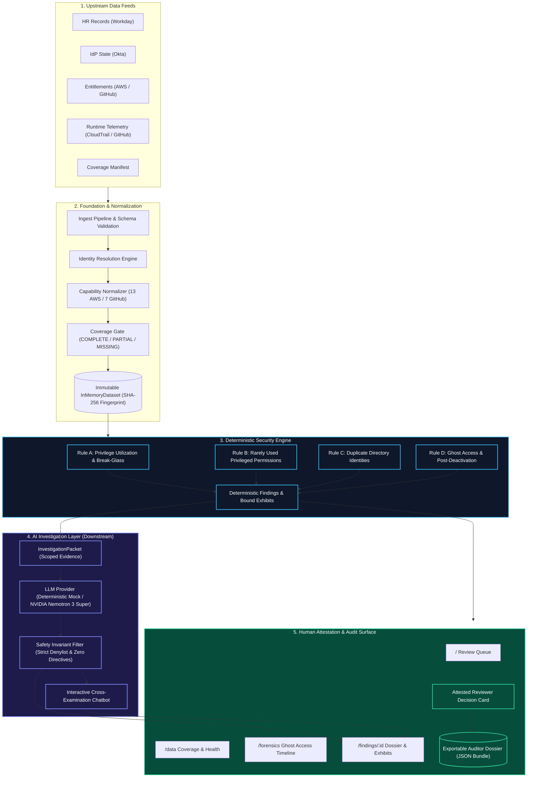

# AccessLens

> **Evidence-first access review & deprovisioning forensics.**  
> A telemetry-informed security system that transforms identity governance from blind rubber-stamping into audit-ready, evidence-backed investigations.

---

## What is AccessLens?

Traditional access reviews periodically ask managers a static question: *"Does this employee still need these permissions?"* Because managers lack technical context and activity records, they routinely click **"Approve"** without verification—a well-known failure mode called **rubber-stamping**. The consequence is privilege creep, unmonitored administrative sprawl, and "ghost access" where credentials remain active long after an employee departs.

**AccessLens** solves this by correlating five independent operational signals:

1. **HR / Workforce Status:** Employee state, termination dates, departments, and managers (e.g., Workday).
2. **Identity Provider (IdP) State:** Account status, login identifiers, and deactivation timestamps (e.g., Okta).
3. **Entitlements & Privileges:** Granted cloud roles, repository permissions, and administrative capabilities (e.g., AWS IAM, GitHub).
4. **Runtime Activity Telemetry:** Real audit events, actions, resource targets, and timestamps recorded over a 90-day lookback window (e.g., AWS CloudTrail, GitHub Audit logs).
5. **Telemetry Coverage Manifest:** Mathematical verification of log health, ensuring no blind spots are mistaken for inactivity.

These inputs are normalized and evaluated through a deterministic, zero-heuristic security engine. The engine produces verifiable security findings supported by immutable exhibits. Downstream, an AI investigation layer organizes the facts, highlights contradictions, and challenges assumptions, while human reviewers retain exclusive authority over all remediation decisions.

### Core Mental Model

$$\mathbf{Operational\ Data} \longrightarrow \mathbf{Deterministic\ Engine} \longrightarrow \mathbf{Finding\ +\ Exhibits} \longrightarrow \mathbf{AI\ Investigation} \longrightarrow \mathbf{Human\ Attestation}$$

* **Deterministic Engine (Python):** The single source of security truth. Computes mathematical privilege utilization, verifies coverage, and enforces deprovisioning boundaries.
* **AI Layer (Mock / NVIDIA Nemotron 3 Super):** Downstream courtroom trial lawyer and explanation assistant. Synthesizes findings into natural language, separates facts from inferences, and drafts adversarial cross-examination questions.
* **Human Reviewer:** The sole decision-maker. Records attested findings (`APPROVED`, `REJECTED`, or `DEFERRED`) with a mandatory audit rationale and exports signed dossiers.

---

## The Problem Space

Modern enterprise IAM environments suffer from systemic structural visibility failures:

1. **Broad Privileges with Narrow Usage:** Engineers receive blanket administrative roles (e.g., AWS `AdministratorAccess`) but routinely exercise only a tiny fraction of granted capabilities (e.g., read-only S3 or EC2 calls).
2. **Break-Glass Inactivity Dilemma:** Emergency disaster-recovery roles are deliberately kept dormant for crisis scenarios. Traditional tools incorrectly flag them as "stale" or "unused," prompting accidental deletion.
3. **Ghost Access Post-Deprovisioning:** When an employee leaves, IT disables their central single sign-on (SSO) account. However, personal access tokens (PATs), SSH keys, or cloud access keys often persist and continue executing unauthorized actions.
4. **Unmonitored Log Blind Spots:** When a telemetry source fails (e.g., an unauthenticated proxy connector), conventional systems treat zero log entries as zero user activity, declaring the account "clean."
5. **Duplicate Identity Sprawl:** Multiple directory accounts assigned to one natural person create shadow access paths that bypass standard deprovisioning workflows.

### Core Security Design Principles

* **"Unknown $\neq$ Safe":** Missing, truncated, or unauthenticated audit telemetry must be classified as `INSUFFICIENT_EVIDENCE`. Silence in logs is never proof of inactivity.
* **"Unused $\neq$ Unnecessary":** Break-glass and emergency roles are structurally protected. Absence of routine activity is their intended operational state.

---

## How It Works

AccessLens operates via a strict 11-stage processing pipeline:

```text
1. Ingestion        ──> Read upstream feeds (HR, IdP, Entitlements, Telemetry, Coverage).
2. Validation       ──> Reject malformed records via strict Pydantic v2 domain schemas.
3. Resolution       ──> Resolve disparate accounts across platforms to unified natural personas.
4. Normalization    ──> Map cloud-specific actions to normalized capability vocabularies.
5. Coverage Gating  ──> Calculate telemetry coverage per persona (COMPLETE, PARTIAL, MISSING).
6. Immutable State  ──> Assemble an in-memory, content-hashed snapshot (InMemoryDataset).
7. Engine Analysis  ──> Execute deterministic Rules A–D with zero LLM involvement.
8. Evidence Binding ──> Attach verifiable, tamper-evident exhibits to each finding.
9. AI Investigation ──> Generate structured dossiers (facts vs. inferences, adversarial queries).
10. Human Review    ──> Security engineer reviews exhibits, conducts interactive cross-examination.
11. Dossier Export  ──> Generate an Exportable Auditor Dossier JSON bundle with attestation notes.
```

---

## Architecture

The following diagram illustrates the complete AccessLens architecture and boundaries:



> **Critical Boundary:** The AI layer sits strictly downstream of the security engine. AI **never** computes findings, alters severity, evaluates necessity, or triggers automated remediation.

---

## Deterministic Security Rules

AccessLens implements four formal security evaluation rules (`backend/app/engine/rules.py`):

| Rule | Problem Detected | Data Consumed | Thresholds / Behavior | Output Classification |
|---|---|---|---|---|
| **Rule A** | **Privilege Utilization & Low Usage** | Entitlements vs. 90-day CloudTrail/GitHub events | Flagged if observed capability ratio $< 0.25$ and $\ge 3$ events. Tagged emergency roles are explicitly protected. Incomplete logs produce insufficient evidence. | `HIGH_PRIVILEGE_LOW_USAGE`<br>`PROTECTED_BREAK_GLASS`<br>`INSUFFICIENT_EVIDENCE` |
| **Rule B** | **Rarely Used Privileged Permissions** | Entitlements vs. high-risk destructive action dictionary | Flags users with high routine activity who never touch sensitive capabilities (`IAM_WRITE`, `KMS_WRITE`, `LOGS_WRITE`, `REPO_ADMIN`). | `RARELY_USED_PRIVILEGED_PERMISSION` |
| **Rule C** | **Duplicate Identity** | Normalized IdP accounts | Flags instances where a single natural persona owns multiple active accounts on a single directory platform. | `DUPLICATE_IDENTITY` |
| **Rule D** | **Ghost Access (Deprovisioning Forensics)** | HR termination date, IdP deactivation timestamp, activity logs | Detects any authenticated activity occurring after formal deactivation. | `GHOST_ACCESS` |

---

## Demo Scenarios & Persona Population

The repository includes a dated, reproducible 9-persona population in `data/` anchored to `2026-09-29T06:00:00Z`:

```text
                      POPULATION MATRIX & TEST ORACLES
┌───────────────┬───────────────────────────────┬──────────────┬─────────────────────────────┐
│ Persona       │ Scenario                      │ Coverage     │ Deterministic Engine Result │
├───────────────┼───────────────────────────────┼──────────────┼─────────────────────────────┤
│ Bob Chen      │ High Privilege / Low Usage    │ COMPLETE     │ HIGH_PRIVILEGE_LOW_USAGE    │
│ Alice Nguyen  │ Protected Break-Glass Role    │ COMPLETE     │ PROTECTED_BREAK_GLASS       │
│ Carol Diaz    │ Post-Termination Ghost Access │ COMPLETE     │ GHOST_ACCESS (Rule D)       │
│ Gina Patel    │ Missing Proxy Telemetry       │ MISSING      │ INSUFFICIENT_EVIDENCE       │
│ Henry Okafor  │ Duplicate Okta Accounts       │ COMPLETE     │ DUPLICATE_IDENTITY (Rule C) │
│ Ivan Petrov   │ Corrupted/Rejected Log Row    │ PARTIAL      │ INSUFFICIENT_EVIDENCE       │
│ Erin Walsh    │ Privileged Capability Dormant │ COMPLETE     │ RARELY_USED_PRIVILEGED...   │
│ Dave Okonkwo  │ Fully Utilized Access         │ COMPLETE     │ Zero Findings (Baseline)    │
│ Frank Moreau  │ Clean Deprovisioning Control  │ COMPLETE     │ Zero Findings (Control)     │
└───────────────┴───────────────────────────────┴──────────────┴─────────────────────────────┘
```

### 1. Bob Chen (`u_bob`) — High Privilege / Low Usage
* **Granted:** AWS `AdministratorAccess` conferring 13 capabilities.
* **Exercised:** 4 CloudTrail events exercising only 2 capabilities (`S3_READ`, `EC2_READ`).
* **Calculation:** Observed utilization ratio $= 2 / 13 = 0.154$ (below the $0.25$ threshold).
* **Verdict:** Flagged for review with 8 verifiable exhibits. AccessLens does not revoke access automatically; a reviewer decides whether downscoping is appropriate.

### 2. Alice Nguyen (`u_alice`) — Protected Break-Glass Exemption
* **Granted:** `AWS_EMERGENCY_ADMIN` and `disaster-recovery-operator`.
* **Exercised:** 0 events across the 90-day lookback window.
* **Coverage:** `COMPLETE`.
* **Verdict:** Classified as `PROTECTED_BREAK_GLASS`. Under Rule C/Rule A, emergency accounts are deliberately kept dormant. Inactivity is expected and protected.

### 3. Carol Diaz (`u_carol`) — Deprovisioning Forensics & Ghost Access
* **Timeline:**
  * `2026-08-14 17:00 UTC`: HR records termination of employment.
  * `2026-08-15 09:12 UTC`: Central Okta identity account disabled via automated SCIM.
  * `2026-08-16 07:30 UTC`: AWS EC2 request using `AKIACAROLKEY` denied (AWS IAM deprovisioning succeeded).
  * `2026-08-19 02:41 UTC`: GitHub `repo.clone` on `northwind/site` succeeds via personal access token `ghp_carol_legacy`.
  * `2026-08-27 23:05 UTC`: GitHub `git.push` on `northwind/site` succeeds.
  * `2026-09-11 04:18 UTC`: GitHub `repo.access` on `northwind/internal` succeeds.
* **Verdict:** Classified as `GHOST_ACCESS`. Highlights orphaned credentials that bypassed central IdP lifecycle management.

### 4. Gina Patel (`u_gina`) — Telemetry Gap & "Unknown $\neq$ Safe"
* **Granted:** `DataPortalAdmin`.
* **Activity:** 0 events recorded.
* **Coverage:** `MISSING`. The Zscaler proxy connector failed authentication (HTTP 401).
* **Verdict:** Classified as `INSUFFICIENT_EVIDENCE`. AccessLens refuses to conclude Gina was inactive because telemetry was never delivered.

### 5. Henry Okafor (`u_henry`) — Duplicate Identity
* **State:** Holds active Okta accounts `00u_henry01` and `00u_henry98-legacy` sharing the same email and login identifier.
* **Verdict:** Classified as `DUPLICATE_IDENTITY`.

### 6. Ivan Petrov (`u_ivan`) — Incomplete Coverage from Rejected Telemetry
* **State:** One CloudTrail record was rejected during ingest due to a truncated ISO-8601 timestamp.
* **Verdict:** Coverage downgraded to `PARTIAL`. Under Rule A, the engine issues `INSUFFICIENT_EVIDENCE` rather than calculating an inaccurate ratio.

---

## AI Investigation Layer

AccessLens incorporates an AI investigation assistant modeled as an **objective courtroom trial lawyer**.

### Architecture & Grounding
1. **The InvestigationPacket:** The API builds an immutable, tamper-evident data packet containing only the verified finding facts, identity metadata, and specific exhibit IDs.
2. **Structured Output:** The AI produces a strict schema containing:
   * **Factual Summary:** High-level narrative grounded in telemetry.
   * **Fact vs. Inference Separation:** Distinct arrays separating verified evidence from operational inferences.
   * **Adversarial Questions:** Counter-queries designed to challenge assumptions (e.g., *"Was this role exercised in an unlogged disaster recovery drill?"*).
   * **Investigation Next Steps:** Concrete, non-automated recommendations for the human investigator.
3. **Interactive Cross-Examination Chatbot:** Reviewers can ask free-form questions directly inside the dossier page (e.g., *"Which repository was accessed after deactivation?"* or *"Could this access be legitimate?"*). Responses cite verified exhibit links that highlight the corresponding card in the UI.

### Safety Invariants & Guardrails
All AI generation passes through a strict programmatic validator (`backend/app/ai/safety.py`) before rendering:

| Safety Invariant | Validator Rule | Rationale |
|---|---|---|
| **Zero Revocation Directives** | Rejects `\brevoke\b`, `\bremove access\b`, `\bdeprovision\b` | AccessLens never prescribes or executes access alterations; humans decide. |
| **Zero Necessity Claims** | Rejects `"unnecessary"`, `"not needed"`, `"safe to delete"`, `"is essential"` | Necessity is an attested business judgement, not an AI inference. |
| **Zero Severity Regrading** | Rejects any attempt to change deterministic severity | Engine severity is calculated by code; AI cannot upgrade or downgrade risk. |
| **Zero Clean Claims under Incomplete Logs** | Rejects `"no activity"`, `"never used"`, `"clean"` if coverage $\neq$ COMPLETE | Protects against false negatives caused by telemetry outages. |
| **Zero Hallucinated Citations** | Every cited ID must exist in `packet.valid_evidence_ids` | AI cannot fabricate evidence exhibits. |

### Dual Provider Support
* **Deterministic Mock (`MockLLMProvider`):** Offline, hermetic provider for local test suites and deterministic continuous integration (default).
* **NVIDIA Hosted (`NvidiaLLMProvider`):** Integration with hosted **NVIDIA Nemotron 3 Super** (`nvidia/nemotron-3-super-120b-a12b`) via OpenAI-compatible endpoints with automated timeout fallback and explicit UI badges.

---

## Human Review Workflow

AccessLens maintains strict human-in-the-loop governance:

```text
Finding Dashboard ──> Inspect Evidence ──> Cross-Examine AI ──> Attest Decision ──> Export Bundle
```

1. **Review Exhibits:** Reviewer inspects the raw, verifiable telemetry exhibits and timeline.
2. **Consult AI Dossier:** Reviewer evaluates the AI-generated facts, inferences, and adversarial questions.
3. **Interactive Q&A:** Reviewer queries the AI assistant to explore hypotheses and examine specific exhibits.
4. **Attested Decision:** Reviewer chooses an explicit status:
   * **APPROVE (Downscope Warranted):** Acknowledges overprivilege or deprovisioning failure and orders manual remediation.
   * **REJECT (Retain Access):** Records a verified business justification (e.g., quarterly standby duty).
   * **DEFER (Need More Evidence):** Requests log investigation or manager interview.
5. **Auditor Dossier Export:** Clicking **"Export Auditor Dossier"** downloads a comprehensive, portable JSON bundle containing the finding, full evidence exhibits, AI analysis, reviewer attestation, and timestamp.

---

## Product Walkthrough & Frontend Surfaces

The Next.js 16 frontend provides four dedicated surfaces:

| URL Route | Screen Name | Operational Purpose |
|---|---|---|
| `/` | **Review Queue** | Prioritized queue of all security findings sorted by severity. Displays user identity, finding summary, telemetry coverage status, and quick links. |
| `/data` | **Data & Ingest Health** | Real-time ingest statistics, rejected row diagnostics, SHA-256 dataset fingerprint, and per-persona telemetry coverage qualification. |
| `/forensics` | **Deprovisioning Forensics** | Dedicated timeline table tracking employee termination, IdP account deactivation, and subsequent unauthorized activity for ghost access cases. |
| `/findings/[id]` | **Auditor Dossier & Investigation** | Complete investigation view featuring raw exhibits, AI investigation card, interactive cross-examination chat, decision form, and JSON export. |

---

## Technology Stack

AccessLens uses a lean, production-grade technology stack with zero unneeded dependencies:

### Backend
* **Runtime:** Python 3.11+ / Python 3.14
* **API Framework:** [FastAPI](https://fastapi.tiangolo.com/) (Asynchronous ASGI)
* **Data Validation:** [Pydantic v2](https://docs.pydantic.dev/) (Strict type enforcement)
* **Database & ORM:** [SQLAlchemy 2.0](https://www.sqlalchemy.org/) with SQLite (PostgreSQL-compatible)
* **HTTP Client:** [HTTPX](https://www.python-httpx.org/) (Async client for NVIDIA hosted inference)
* **Package Management:** [`uv`](https://github.com/astral-sh/uv) (Ultra-fast Python package installer and runner)
* **Testing:** [pytest](https://docs.pytest.org/) with `anyio`

### Frontend
* **Framework:** [Next.js 16](https://nextjs.org/) (App Router, Turbopack)
* **UI Library:** [React 19](https://react.dev/)
* **Language:** [TypeScript](https://www.typescriptlang.org/) (Strict type checking)
* **Styling:** [Tailwind CSS v4](https://tailwindcss.com/) (Modern CSS `@theme` tokens)
* **Browser Automation & E2E:** [Playwright](https://playwright.dev/)

---

## Project Structure

```text
access-lens/
├── backend/
│   ├── app/
│   │   ├── ai/                  # AI packet builder, schemas, mock & NVIDIA providers, safety filters
│   │   │   ├── investigator.py  # Orchestrates packet generation and safety validation
│   │   │   ├── nvidia_provider.py # Real NVIDIA Nemotron 3 Super hosted API integration
│   │   │   ├── provider.py      # Abstract LLMProvider and deterministic mock provider
│   │   │   ├── safety.py        # 5 programmatic safety validators and regex denylists
│   │   │   └── schemas.py       # StructuredInvestigationResult and chat schemas
│   │   ├── api/
│   │   │   ├── read_models.py   # Normalized view models
│   │   │   └── v1/
│   │   │       ├── analysis.py  # /api/analysis findings, dossiers, and chat endpoints
│   │   │       ├── health.py    # /api/health ingest statistics and dataset status
│   │   │       └── personas.py  # /api/personas directory views
│   │   ├── core/                # Settings, enums, capability dictionary, time discipline
│   │   ├── engine/              # Deterministic Rules A–D and unified analyze() entry point
│   │   ├── ingestion/           # Feed loaders, normalizer, identity resolution, pipeline
│   │   └── models/              # Portable SQLAlchemy database tables
│   ├── tests/                   # Pytest suite (405 tests) and test oracles
│   │   ├── test_ai_chat.py      # Tests for interactive review chatbot and prompt grounding
│   │   ├── test_ai_investigation.py # Tests for AI investigation packets and safety filters
│   │   └── fixtures/oracles/    # Written expected finding outcomes
│   ├── pyproject.toml           # Backend project definition and dependencies
│   └── requirements.txt         # Pinned backend dependencies
├── frontend/
│   ├── app/                     # Next.js 16 App Router
│   │   ├── page.tsx             # / Review Queue
│   │   ├── data/page.tsx        # /data Ingest Health & Coverage
│   │   ├── forensics/page.tsx   # /forensics Deprovisioning Forensics
│   │   ├── findings/[id]/page.tsx # /findings/[id] Finding Dossier & Review
│   │   └── api/analysis/findings/[id]/investigation/ # Next.js API proxy handler
│   ├── components/              # React components (InvestigationPanel, InvestigationChat, Exhibit)
│   ├── e2e/                     # Playwright end-to-end tests (55 tests)
│   │   ├── chat.spec.ts         # Playwright suite for AI chat
│   │   └── manual_verification.spec.ts # 12 manual browser verification scenarios
│   ├── lib/                     # API fetchers, formatting utilities, cx helper
│   ├── types/api.ts             # TypeScript interfaces matching backend schemas
│   └── package.json             # Frontend dependencies and build scripts
├── data/                        # Bundled synthetic multi-source fixture feeds
│   ├── users_hr.json            # Workday HR employee export
│   ├── idp_state.json           # Okta identity accounts export
│   ├── entitlements.json        # AWS IAM and GitHub permission grants
│   ├── activity_logs.json       # AWS CloudTrail and GitHub audit log records
│   └── coverage_manifest.json   # Declared lookback window coverage status
├── docs/                        # Architecture reference documentation
└── reports/                     # Output directory for ingest reports
```

---

## Running Locally

### Prerequisites
* **Python:** Version 3.11 or newer (installed with `uv` recommended)
* **Node.js:** Version 20 or newer (with `npm`)

### 1. Backend Setup

```bash
# Navigate to backend directory
cd backend

# Create virtual environment and install dependencies
uv venv
uv pip install -r requirements.txt

# Copy environment configuration (REQUIRED for bundled fixtures)
cp .env.example .env

# Start the FastAPI backend server
uv run uvicorn app.main:app --host 127.0.0.1 --port 8000
```

> **Why `.env` is required:** The synthetic demo dataset in `data/` is anchored to instant `2026-09-29T06:00:00Z`. `.env.example` pins `ACCESSLENS_ANALYSIS_AS_OF` to this date so the 90-day lookback window accurately captures all demo activity.

### 2. Frontend Setup

```bash
# In a separate terminal, navigate to frontend directory
cd frontend

# Install dependencies
npm install

# Start Next.js development server
npm run dev
```

### 3. Access the Application
* **Frontend Review Surface:** [http://localhost:3000](http://localhost:3000)
* **Backend API Documentation:** [http://127.0.0.1:8000/docs](http://127.0.0.1:8000/docs)
* **Ingest & Health Check:** [http://127.0.0.1:8000/api/health](http://127.0.0.1:8000/api/health)

---

## Testing & Verification

The AccessLens repository contains exhaustive, hermetic test suites with zero external network dependencies:

### 1. Backend Unit, Engine & AI Tests (pytest)
Runs 405 automated tests verifying data ingestion, capability normalization, Rules A–D, AI investigation packets, safety validators, and chat grounding:

```bash
cd backend
uv run pytest
```
* **Status:** `405 passed, 1 skipped in ~24s`

### 2. Frontend Type Checking & Production Build
Compiles all pages and server routes via Next.js Turbopack:

```bash
cd frontend
npm run build
```
* **Status:** Compiled with `0 errors and 0 warnings`

### 3. End-to-End Browser Tests (Playwright)
Executes 55 headless browser tests across all application views and user flows:

```bash
cd frontend
npx playwright test
```
* **Status:** `55 passed in ~54s`

---

## Prototype Scope vs. Production Roadmap

To maintain technical honesty and credibility, the boundary between implemented capabilities and future architecture is clearly delineated:

### Fully Implemented Today
* [x] Multi-source ingestion pipeline with Pydantic validation and identity resolution.
* [x] Deterministic Rules A–D with zero-heuristic finding generation.
* [x] Mathematical coverage gating (`COMPLETE`, `PARTIAL`, `MISSING`).
* [x] Ephemeral in-memory dataset with content-hashed fingerprinting.
* [x] FastAPI REST endpoints for analysis, personas, and health.
* [x] Complete Next.js 16 review dashboard, forensic timeline, and dossier pages.
* [x] AI Investigation layer (`InvestigationPacket`, facts vs. inferences, adversarial questions).
* [x] 5 programmatic safety validators enforcing zero-directive and grounded citation rules.
* [x] Interactive contextual cross-examination chatbot with exhibit highlighting.
* [x] Offline deterministic `MockLLMProvider` and hosted `NvidiaLLMProvider` (Nemotron 3 Super).
* [x] Attested reviewer decision card with Exportable Auditor Dossier JSON bundle download.

### Production Roadmap (Future Evolution)
* [ ] **Live SaaS Connectors:** Replacing static JSON feed files with authenticated polling/webhook connectors (Workday REST, Okta Event Hooks, AWS CloudTrail S3 / EventBridge, GitHub Audit API).
* [ ] **Multi-Tenant Persistence:** Upgrading SQLite to multi-tenant PostgreSQL with row-level security (RLS) for enterprise deployments.
* [ ] **Cryptographic Dossier Signing:** Applying asymmetric ECDSA signatures to exported auditor bundles for verifiable chain-of-custody in regulatory filings.
* [ ] **Ticket Dispatch Integration:** Generating downstream Jira, ServiceNow, or GitHub issues upon human reviewer attestation.
* [ ] **Automated Remediation Workflows:** Optional API connectors to dispatch human-approved policy adjustments to AWS IAM or Okta SCIM.

---

## Security & Ethics Disclosures

1. **Synthetic Demo Data:** All names, email addresses, employee IDs, and tokens in `data/` are entirely synthetic and fictitious. Any resemblance to real persons or systems is coincidental.
2. **Prototype Notice:** AccessLens is an advanced architectural reference implementation and security prototype. It is not an officially certified SOC 2 or FedRAMP compliance platform.
3. **Human Primacy:** AccessLens is architected to assist human decision-makers, not replace them. Automated credential revocation is deliberately omitted by design.

---

## License

This project is licensed under the Apache License, Version 2.0. See [`LICENSE`](LICENSE) for details.
